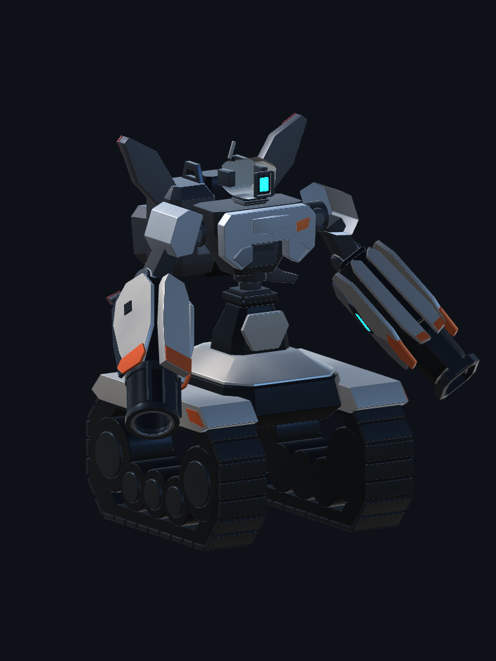
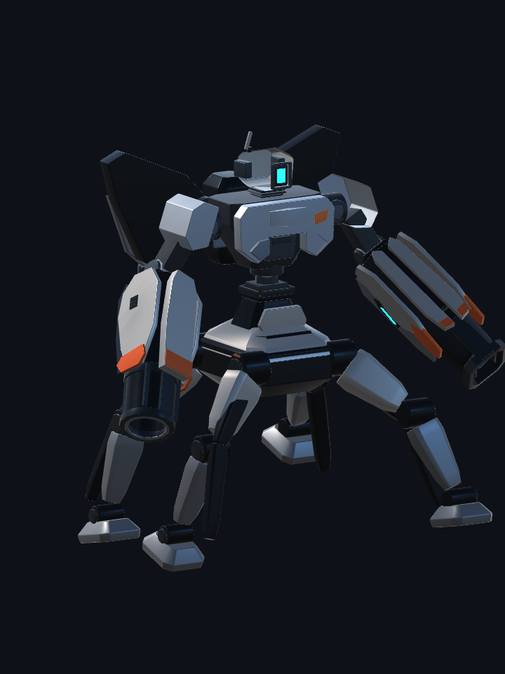
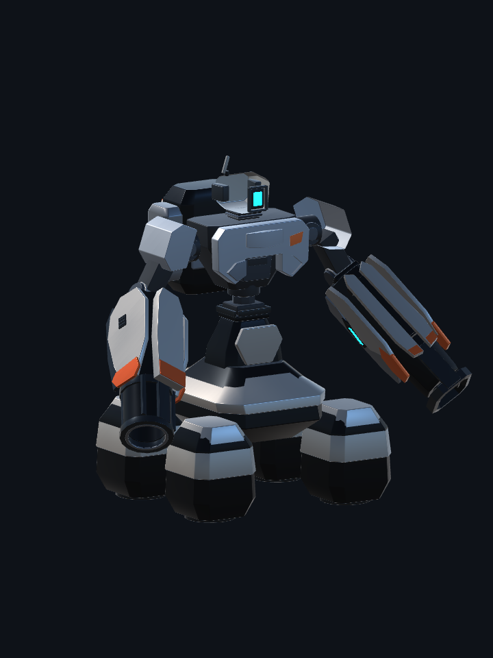
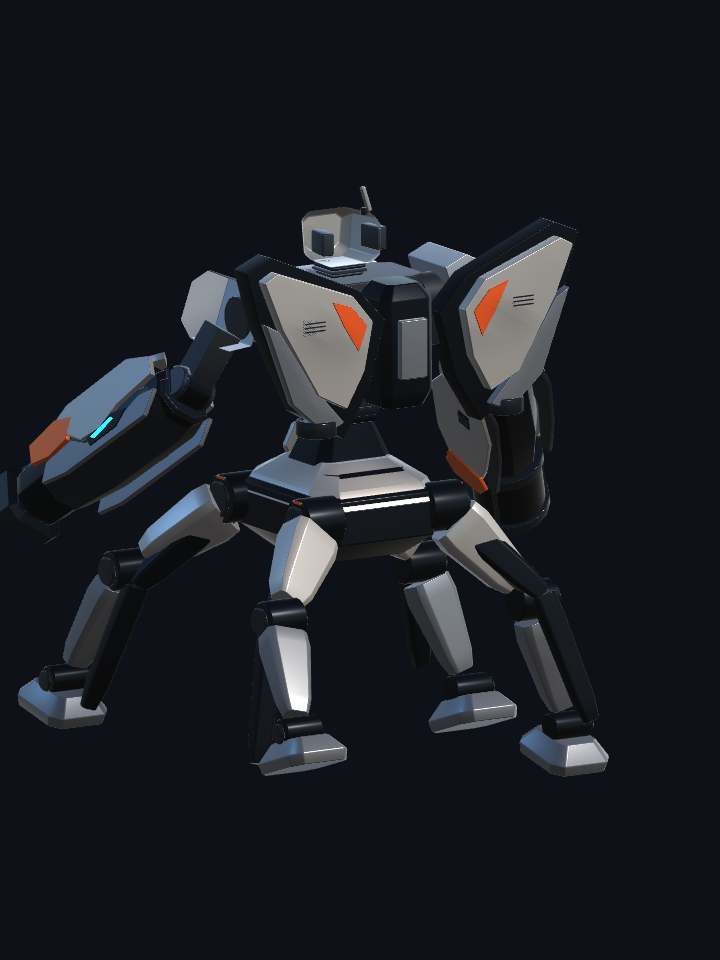
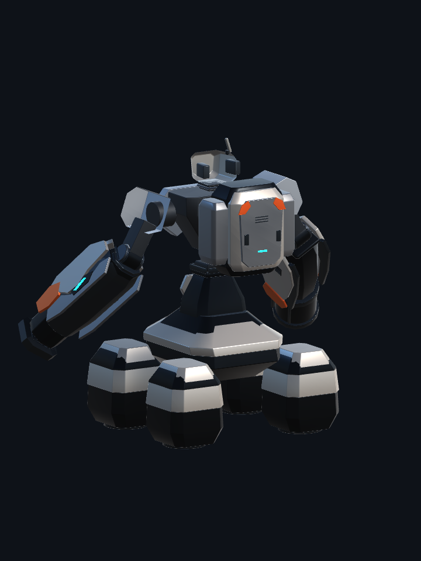

# Blender 신규 파츠 게임 연결 — 2026-11-18

## 이번 변경

대기 중이던 Blender 후보 백팩 2종과 하체 3종을 런타임 파츠 선택 화면에서 고를 수 있게 연결했다. 기존 `B-02`, `B-03`, `L-02`, `L-03` 런타임 파츠와 번호/이름이 겹치는 문제를 막기 위해 새 후보에는 `VIS_` 접두어 ID를 부여했다. 선택값은 기존 캐릭터별 외형 저장 파일에 기록되며 전투 수치와 이동 물리는 변경하지 않는다.

| 새 선택 이름 | 고유 런타임 ID | 검증된 연결 |
|---|---|---|
| 스카이윙 백팩 | `VIS_B02_SKYWING` | 등 장착점 연결 |
| 카고 백팩 | `VIS_B03_CARGO_PACK` | 등 장착점 연결 |
| BASTION 전차 하체 | `VIS_L02_BASTION_TRACK` | 허리 접합 확인 |
| TARANTULAN 사족 하체 | `VIS_L03_TARANTULAN` | 허리 접합, 4개 다리의 고관절·무릎·발목 동작 확인 |
| DRAFT 호버 하체 | `VIS_L04_DRAFT_HOVER` | 허리 접합 확인 |

기존 로봇 표면으로 돌아가는 외형 토글은 일반 선택 화면에서 제거했다. WISP, BASTION, TARANTULA에는 새 Blender 표면을 사용하고 원본 파일은 보관한다. HOUND는 아직 새 대응 모델이 없어서 기존 개 전용 모델을 유지했다.

### 동작상 한계

- 새 BASTION 궤도 후보, 두 백팩, DRAFT 호버 후보는 원본 handoff에서 정지 포즈용 blockout으로 표기되어 있어 별도 파츠 애니메이션을 주장하지 않는다. 기존 전투 이동은 그대로 유지된다.
- 새 TARANTULAN은 12개 관절 피벗을 연결해 걷는 동안 움직이는 것을 확인했다.
- Blender 소스 파일은 읽기만 했고 저장하지 않았다. 기존 런타임 파츠를 덮어쓰지 않았다.
- 캐릭터 전체와 실제 UI를 마우스로 직접 조작하는 검수는 하지 않았다. 숨김 실행에서 게임 화면 캡처는 검게 나와 UI 캡처 자료로 사용할 수 없었다. 외형 캡처는 게임의 실제 렌더 텍스처에서 저장했다.

## 비교 캡처

아래 이미지는 선택 목록에서 각 신규 하체 또는 백팩을 장착한 동일한 게임 카메라 방향의 플레이어 렌더다.

## 실제 검증 결과

- Blender 4.5.15 백그라운드 변환: 신규 후보 5개 생성, 기존 Blender `.blend` 파일 미저장.
- ID/카탈로그/원본 경로 검사: 통과.
- Unity 6000.6.7f1 Windows 빌드: `VOXSKY_BUILD_PASS 254961641 bytes`, `Logs/Visual-Candidate-Build-20261118-6.log`.
- 빌드 플레이어 외형/장착 검토: **54개 런타임 검사 통과**, `%TEMP%\voxelon-visual-candidate-review\WispFamily-Final3.log`.
- 플레이어 회귀 스모크: **377개 통과**, `%TEMP%\voxelon-visual-candidate-smoke-final\Smoke.log`.
- 빌드가 자동 생성한 `Assets/Scenes/Arena.unity`와 `ProjectSettings/ProjectSettings.asset`은 빌드 전 파일로 복원했다.
- 사용자 승인, 실제 클릭 조작 및 눈으로 보는 최종 밸런스/애니메이션 승인은 아직 대기 중이다.

## 데이터 경계

`main`, 씬, Blender 원본, 밸런스 설계 수치는 수정하지 않았다. `Data/Balance/PD-Balance.json`에는 이 작업 이전부터 로컬 변경이 있었으므로 보존했고, 이 작업에서는 열거나 저장하는 테스트를 하지 않았다. 모든 변경은 `codex/pd-review-fixes-20261114` 작업 복사본에만 남아 있으며 아직 커밋/푸시하지 않았다.
