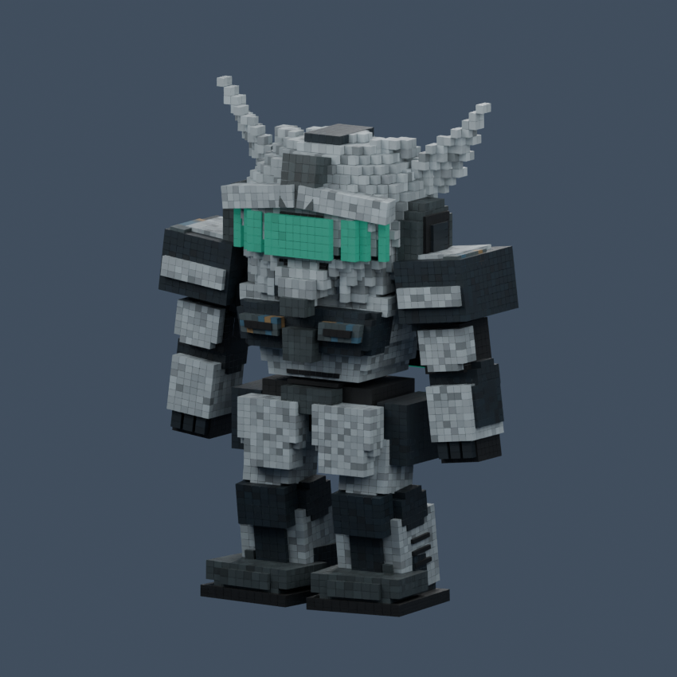

# WISP v004 — 톤다운 아트 후보

Blender에서 v003을 바탕으로 만든 별도 버전입니다. 원본 v001/v002/v003은 보존했습니다. 회청색·먹색 장갑, 청록 센서, 억제된 황토색 표식으로 바꾸고 안테나 길이만 소폭 조정했습니다. 기존 24개 관절, 112개 스킨 부품, 무릎을 살짝 굽힌 자세와 발 위치를 유지했습니다.

- 편집 원본: Assets/Art/Robots/WISP/Source/WISP_v004.blend
- Unity: Assets/Art/Robots/WISP/WISP_v004.fbx 및 Textures/WISP_{BaseColor,Emission}_v004.png
- 재현: Tools/Art/overnight_blender_20261104.py (v003 원본을 열고 실행, v004 및 환경 v001 출력; 수작업 추가 시 새 버전 경로 사용)
- 기존 WISP_Rig_v003 및 소켓 이름은 연결 호환성을 위해 유지합니다. v003 명칭이 보여도 실제 연결 FBX는 v004입니다.
- FBX 원래 축/단위 변환을 유지하고 게임 시각 크기 1.75 × 기체 크기0.85를 적용합니다. 시각 높이 약4.038, 바닥Y=-0.910. 기체를 다시 축소하지 않았습니다.

[정면](WISP-v004-front.png) · [후면](WISP-v004-rear.png) · [실내 게임](Foundry-WISP-crosshair-camera.png) · [실외 게임](Canyon-WISP-crosshair-camera.png)

Windows Unity 빌드 및268개 회귀 검사, 실내외 환경51개 검사 통과. 렌더 이미지와 실제 게임 화면을 확인했습니다. 장시간 수동 플레이 및 최종 아트 승인은 남아 있습니다. work 후보이며 main 미반영입니다.
