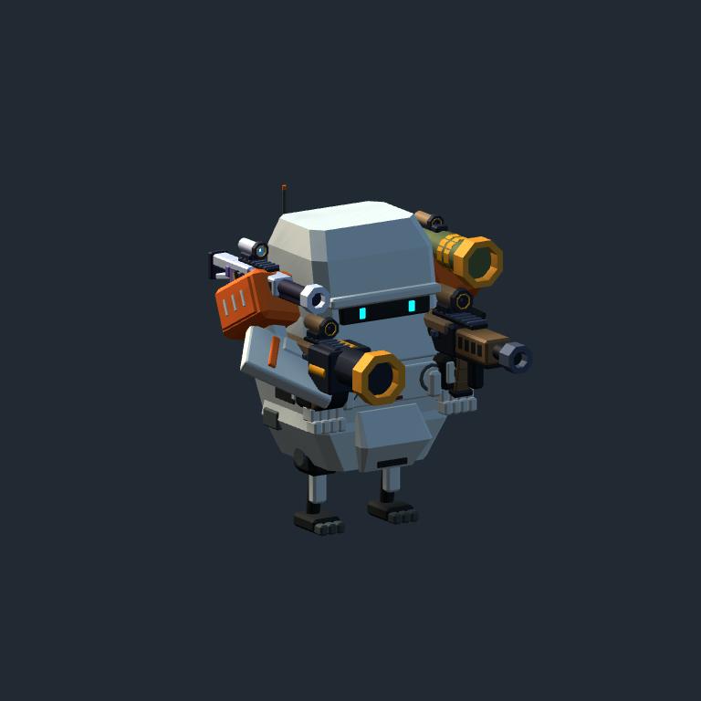

# 조작 버그 수정 — 실제 비교

박PD 승인 범위: V 음소거 단축키 제거, 락온 카메라·약한 보조조준·총기 파지·사족 보행 수정. 외장 모델은 그대로이며 새 무기 그래픽/조립/에너지 규칙은 이번 범위가 아닙니다.

| 실제 같은 카메라 | 변경 전 | 변경 후 |
| --- | --- | --- |
| WISP 파지 | [이전](Before/1-WISP-aim.png) | [이후](After/1-WISP-aim.png) |
| BASTION 파지 | [이전](Before/2-BASTION-aim.png) | [이후](After/2-BASTION-aim.png) |
| TARANTULA 파지 | [이전](Before/3-TARANTULA-aim.png) | [이후](After/3-TARANTULA-aim.png) |
| TARANTULA 저속 보행 | [이전](Before/3-TARANTULA-walking.png) | [이후](After/3-TARANTULA-walking.png) |

동일 카메라/속도 조건이며 보행 캡처는 실제 시간 기준이라 정확히 같은 관절 위상은 아닙니다. 팔꿈치 굽힘 약11~15도→약75도, 총구 정방향 유지. 지지발 평균 미끄럼은 2m/s 이동 조건에서1.99→0.66m/s로 감소했으며 완전히0이 된 것은 아닙니다.

[F2 VISUAL 보폭·발 높이 조절](After/quad-live-settings.png). 값은 시각 보행용이며 실제 이동속도/대시 규칙을 바꾸지 않습니다.

추가 실제 전투/가드/복원 화면은 [Generated](Generated/)에 원래 경로와 함께 보관했습니다. 기존 야간 갤러리를 덮어쓰지 않도록 새 캡처를 복사하고 원래 추적 이미지는 복원했습니다. [생성 원본 경로와 해시](generated-manifest.json), [검증 로그](../../Validation/Controls-20261105/), [수정 결과](../../Development/Controls-Fix-20261105.md).

최종 빌드204697938bytes/전체357PASS/새 조작18PASS. 같은 보행 코드로 하체 접지6개, 전투21개, 3리그 복원27개도 통과했습니다. 자연스러움과 락온 체감의 최종 수동 승인은 아직입니다.
