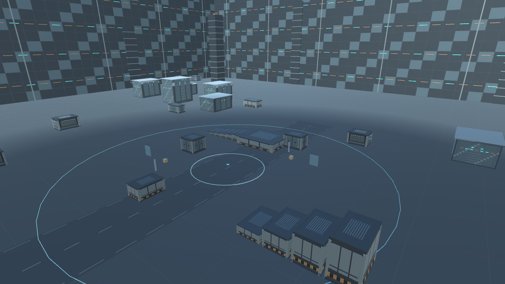
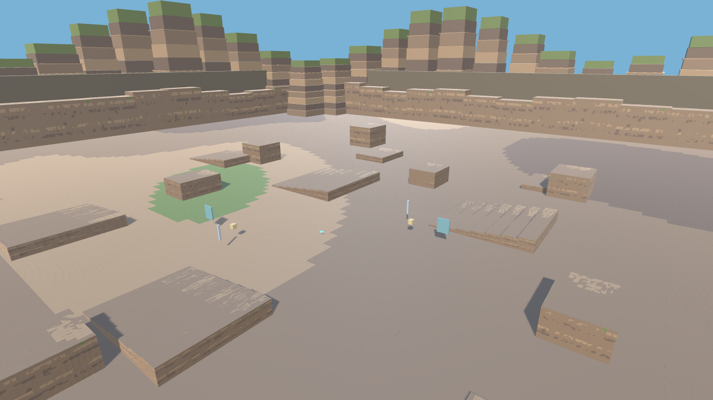
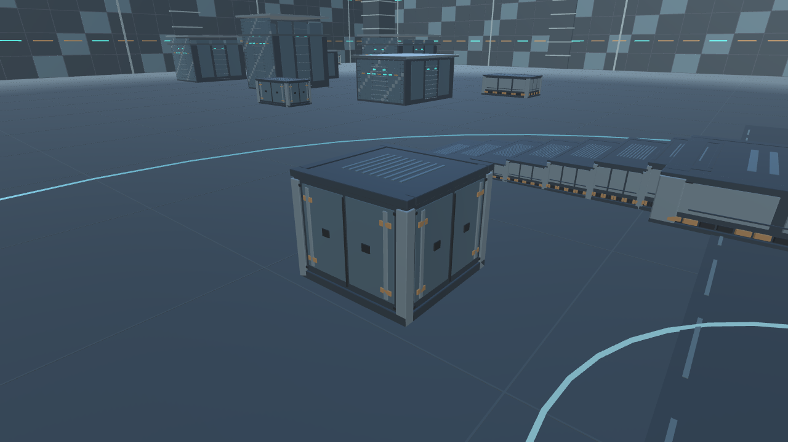
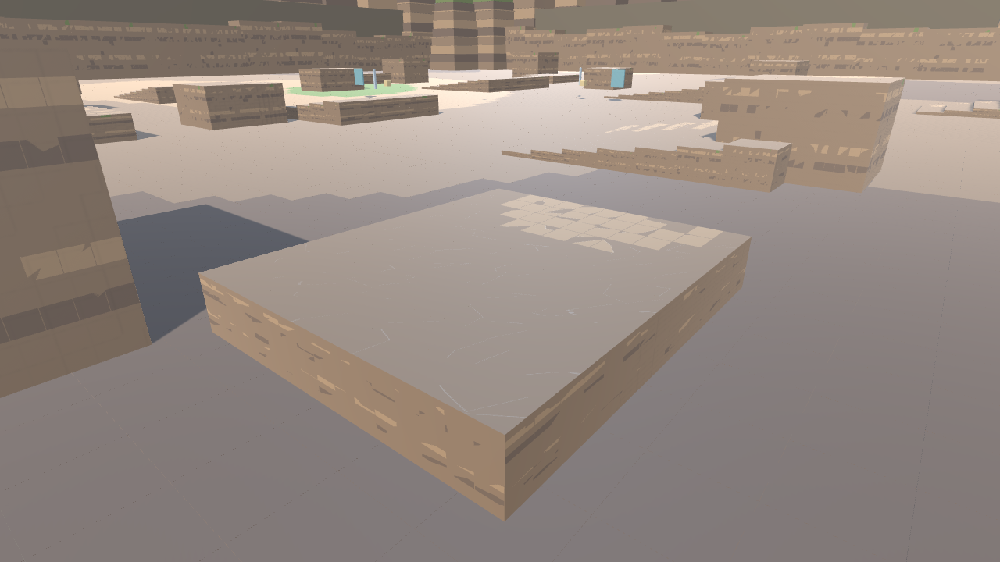

# 2026-11-04 Blender 환경 FBX 검증

첫 야간 체크포인트. 실제 Windows 플레이어에서 렌더했습니다. 기본 소스와 원본 모델은 보존했습니다. 품질 개선 진행 중이며 최종 컨셉 완성본은 아닙니다.

| 실내 Foundry | 실외 Canyon |
|---|---|
|  |  |
|  |  |

- Unity 빌드 성공, 전체 스모크268/268, Foundry36/36+Canyon15/15 환경 검사.
- FBX 축/단위 변환 오류를 수정한 뒤 촬영했습니다. 장애물의 바닥·상단과 충돌 높이를 비교했습니다.
- [실내 WISP 실제 게임](../../Models/Foundry-WISP-crosshair-camera.png), [실외 WISP 실제 게임](../../Models/Canyon-WISP-crosshair-camera.png), [WISP v004 Blender 렌더](../../Models/WISP-v004-three-quarter.png).
- 수동 장시간 플레이와 아트 최종 승인은 남아 있습니다. main 미반영.

## 두 번째 비교

현재 이미지는 Blender 환경 v002입니다. [이전 실내](Before-v002/Foundry-cover.png)와 비교해 문/프레임/환기구 구조를 구분했고, [이전 실외](Before-v002/Canyon-overview.png)의 반복 바닥 무늬를 완화했습니다. 패널의 겹친 면도 수정하고 다시 빌드·검증했습니다. 최신 빌드268/268, 환경51/51 통과. [WISP v004 모델](../../Models/WISP-v004-Handoff.md).
