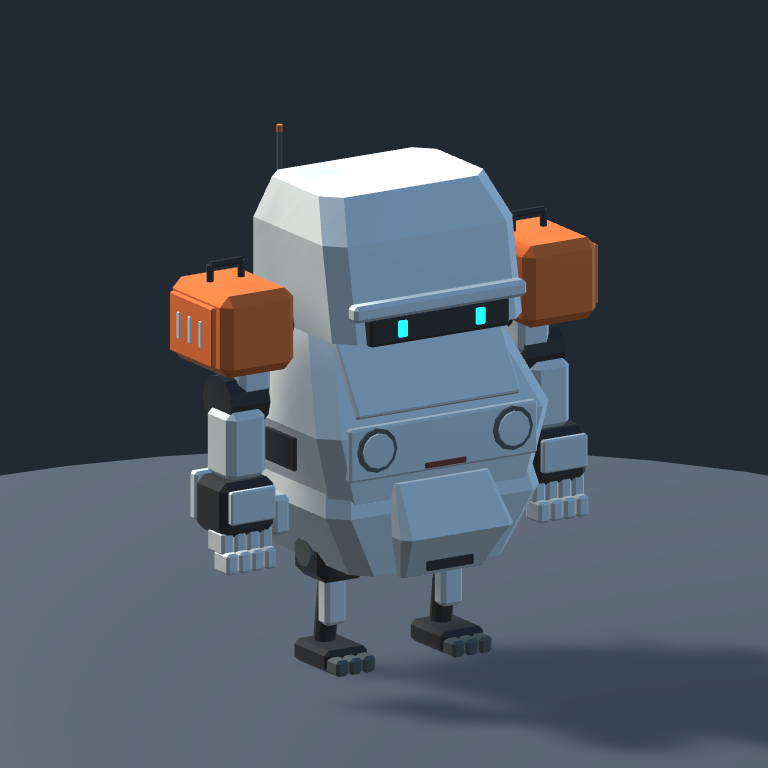
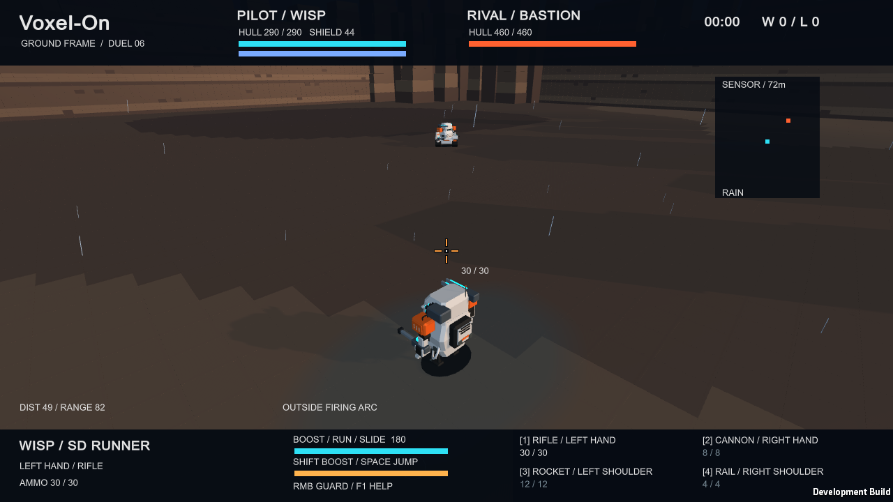

# 11월 5일 야간 후보 — 실제 Unity 화면 26장

컨셉 이미지가 아닌 Windows 플레이어의 실제 렌더입니다. 05시대 최종 모델 WISP_v011 / BASTION_v006 / TARANTULA_v005 기준. [원본 경로·SHA256](manifest.json), [실제 테스트 로그](../../Validation/Overnight-20261105/), [요청별 상태](../../SOL-IMPLEMENTATION-STATUS-20261105.md). PD의 최종 외형·플레이 승인은 아직입니다.

## 3기체 외형

| 기체 | 정면 | 오른쪽 | 후면 | 왼쪽 | 사선 |
| --- | --- | --- | --- | --- | --- |
| 1 WISP | [정면](1-WISP-front.png) | [오른쪽](1-WISP-right.png) | [후면](1-WISP-rear.png) | [왼쪽](1-WISP-left.png) | [사선](1-WISP-three-quarter.png) |
| 2 BASTION | [정면](2-BASTION-front.png) | [오른쪽](2-BASTION-right.png) | [후면](2-BASTION-rear.png) | [왼쪽](2-BASTION-left.png) | [사선](2-BASTION-three-quarter.png) |
| 3 TARANTULA | [정면](3-TARANTULA-front.png) | [오른쪽](3-TARANTULA-right.png) | [후면](3-TARANTULA-rear.png) | [왼쪽](3-TARANTULA-left.png) | [사선](3-TARANTULA-three-quarter.png) |

TARANTULA는 다리 전체를 담는 3.6 orthographic 전신 뷰, 1·2번은 2.5 뷰입니다. 기체끼리 이미지상의 크기를 절대 크기 비교로 해석하지 마세요. 같은 기체의 이전/이후 비교 카메라는 각 반복 기록에 있습니다. 스튜디오 조명이 차갑게 보여도 재질은 오프화이트이며 실제 전장 화면도 함께 봐 주세요.

[박PD 지정 소체](../../VisualReferences/Nacchin-20261105/Reference-5.png) → [반복01](../NacchinStyle-20261105/Iteration01/) → [반복03](../NacchinStyle-20261105/Iteration03/) → [반복05 호스](../NacchinStyle-20261105/Iteration05/README.md) → [반복06 궤도·접지 비교](../NacchinStyle-20261105/Iteration06/README.md).

## 실제 메뉴·전장

- 선택 화면: [WISP](Hangar-WISP.png), [BASTION](Hangar-BASTION.png), [TARANTULA](Hangar-TARANTULA.png). 4무장과 기체별 조작 안내 수정 후 촬영했습니다.
- Foundry: [기본 뒤 시점](Foundry-rear-camera.png), [가드](Foundry-guard.png).
- Canyon: [뒤 시점](Canyon-rear-camera.png), [저녁 비](Canyon-Rain-Evening.png), [저녁 뇌우](Canyon-Thunderstorm-Evening.png).
- 실제 이동·사격 중: [WISP](Canyon-WISP-moving.png), [BASTION](Canyon-BASTION-moving.png), [TARANTULA](Canyon-TARANTULA-moving.png).

조명 전후는 [기존/1차/2차 같은 각도](../PD14-Lighting/README.md), 탄환은 [4종 실제 발사체 확대 검사](../PD14-Projectiles/README.md), 효과는 [부위 연기·파괴·공중 분사](../PD14-Effects-Iteration04/)에서 봅니다. 확대 검사 사진을 정상 게임 화면 크기로 해석하지 않습니다. 최종 갤러리는 서로 다른 검증 장면의 대표 화면이며 수동 플레이 승인 증거는 아닙니다.

추가 복원 검증9장: [3기체 실제 사망·재시작 전후](../PD14-Module-Recovery/README.md). 대표 갤러리26장과 별도이며, 최초 즉시 렌더 probe를 성공으로 오인하지 않고 정상 프레임 후 실루엣 일치까지 확인했습니다.
