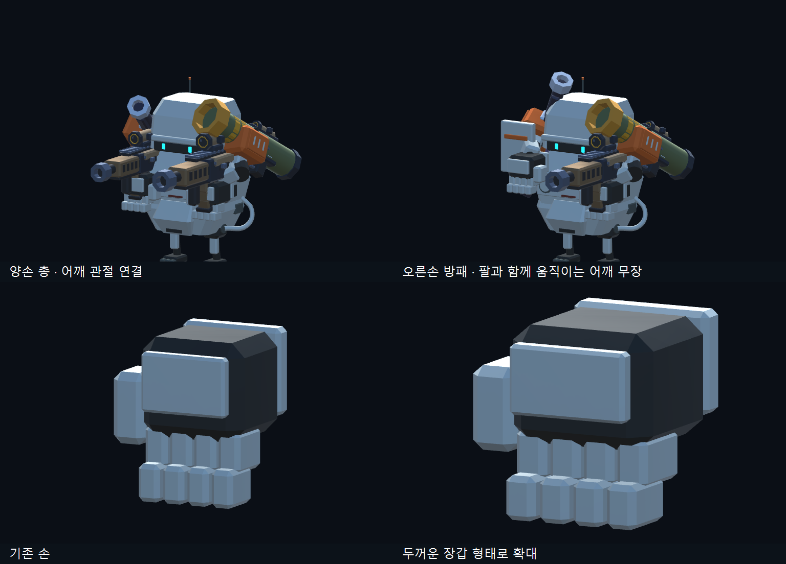

# 무기·장갑·장착 비교 갤러리

최종 장착은 실제 어깨 관절을 따라갑니다. 높은 머리 위 고정 버전과 초기 촬영은 이력으로 보존하며 최종 승인 자료로 사용하지 않습니다.

- [무기32종 실제 Unity 렌더](Unity-v003-EquipmentFinal/Catalog-32.png)
- [옵션 창·양손 장착·주먹](../Balance-Editor-20261105/Final/)
- [세 기체 장갑 전후](../GloveHands-20261105/Final/)
- [실내 전투](Combat/IndoorFactory/) / [실외 전투](Combat/OutdoorCanyon/)
- [검증 기록과 제한](../../Development/Equipment-Editor-20261105.md)

미술 최종 승인과 수동 플레이 검토는 박PD 확인 대기입니다.
