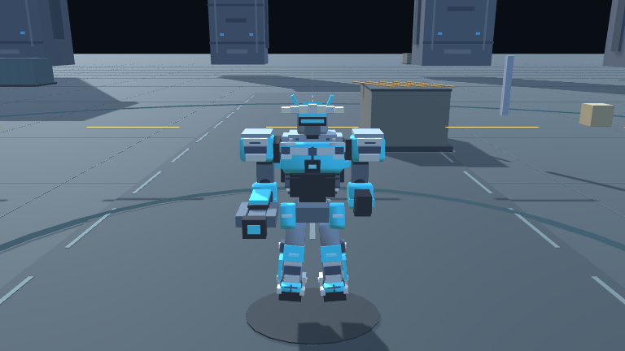
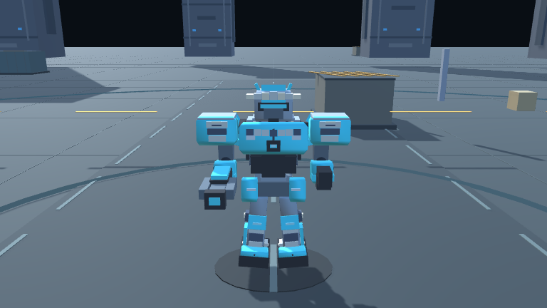
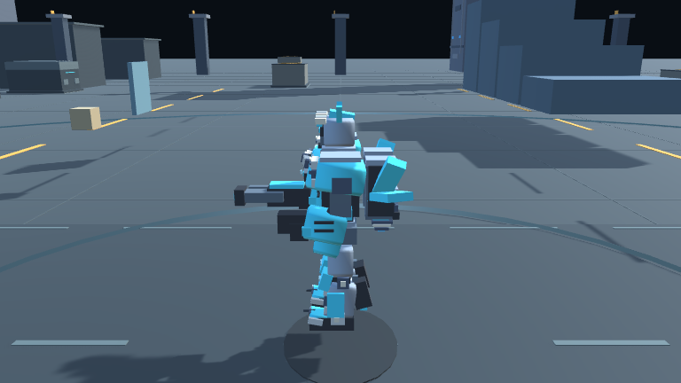
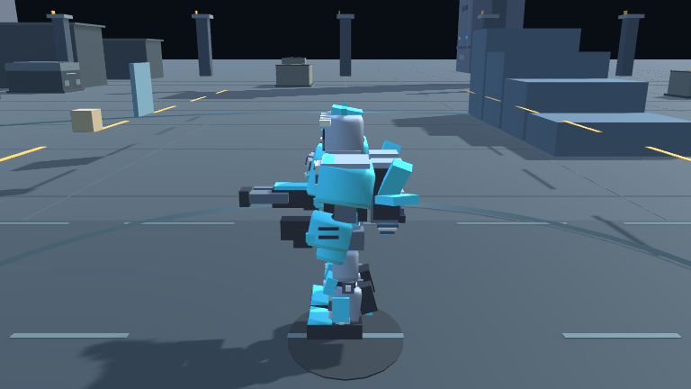
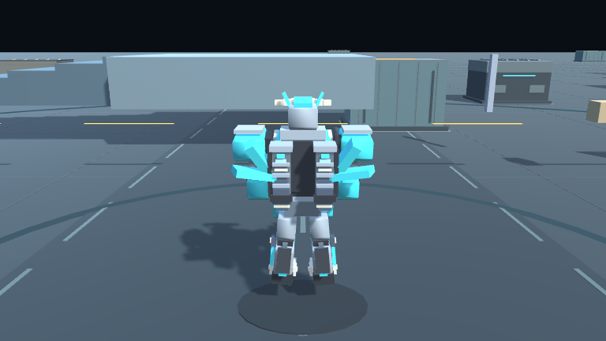
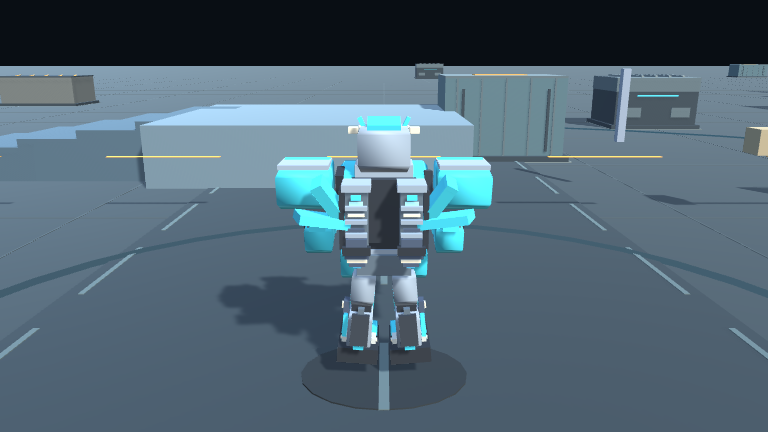

# Kestrel SD 비율 및 지면 충돌 수정

기준 커밋 `f808e59`의 Kestrel 기본 실루엣과 이번 변경을 비교합니다. 장식 파츠 추가 대신 머리, 상체, 어깨, 골반과 발의 크기 비율을 먼저 조정했습니다. 세부 장식은 아직 추가하지 않았습니다.

## 실루엣 비교

| 방향 | 변경 전 | 변경 후 |
| --- | --- | --- |
| 정면 |  |  |
| 측면 |  |  |
| 후면 |  |  |

## 구현 내용

- Kestrel 머리·가슴·어깨·골반·발 비율을 키워 SD형 실루엣을 강화했습니다.
- 바닥 표면 높이를 하나의 기준으로 맞추고, 각 엄폐물의 충돌 바닥과 꼭대기를 보이는 모델의 높이에 맞췄습니다.
- 낮은 단차 접근 시 이동을 막지 않도록 스텝 착지 높이를 조정했습니다. 점프 후 옥상 착지 검증 경로는 가장자리에서 벗어나지 않도록 중앙에서 멈추게 바로잡았습니다.
- 기체 그림자와 지상 장식의 기준 높이를 조정했습니다.

## 전장 화면

성공한 Windows 플레이어에서 생성한 실제 전장 캡처입니다. 로봇 8종의 앞·뒤·좌·우와 전장 4구역을 포함해 총 36장을 촬영했습니다.

전체 갤러리: [기체 32장](../Robots/) · [전장 4장](../Arena/)

## 검증 기록

- Unity `6000.6.7f1` Windows 개발 빌드 성공: `VOXSKY_BUILD_PASS 158016042 bytes`.
- 생성된 Windows 플레이어에서 자동 스모크 검사 209개 통과: `VOXSKY_SMOKE_PASS 209 checks`.
- 플레이어에서 갤러리 캡처 36장 생성: `VOXSKY_GALLERY_PASS 36 images`.
- 별도 수동 조작 플레이테스트는 아직 하지 않았습니다. 바닥 충돌과 옥상 착지는 자동 검사로 확인했습니다.
- 작업 브랜치: `codex/implementation/2026-11-01-sd-ground`. `main`에는 반영하지 않았습니다.
