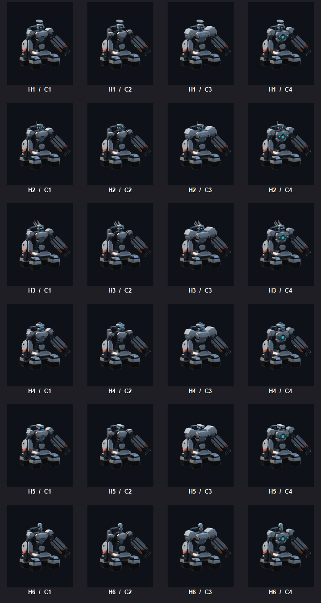
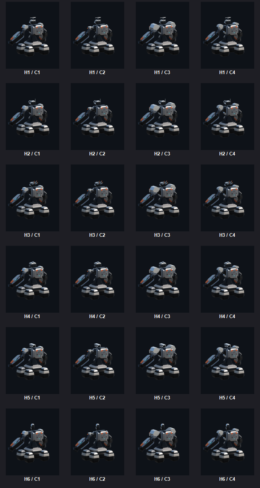
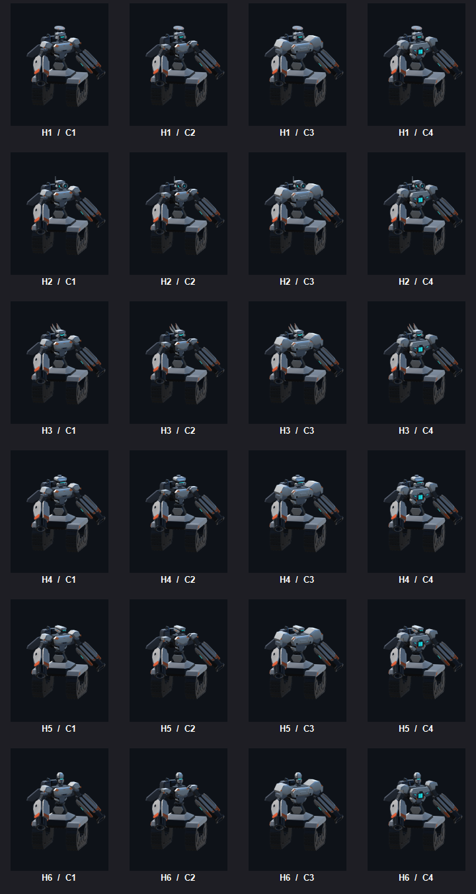
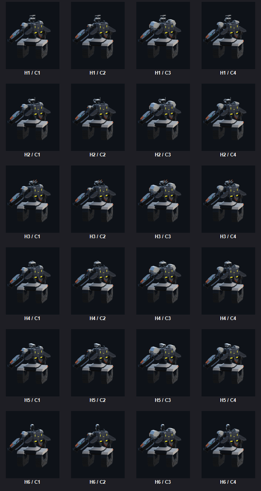
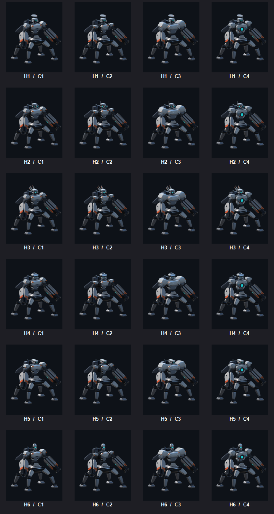
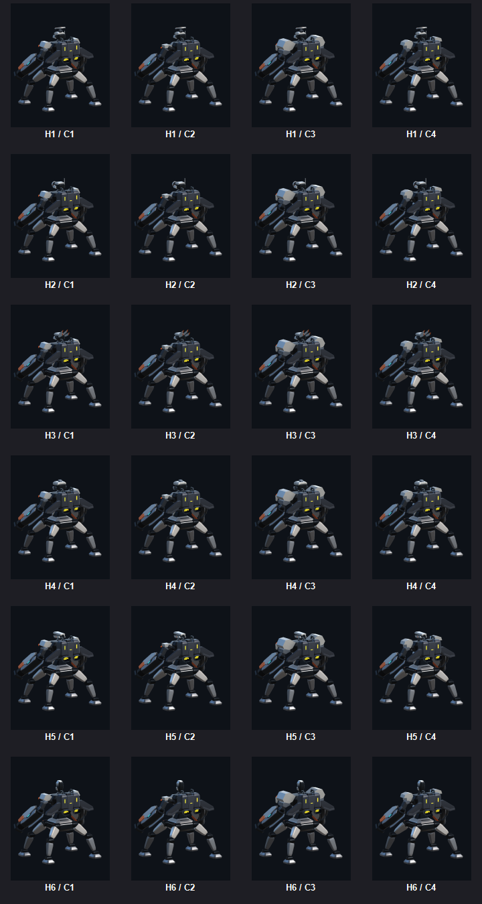

# Head × core visual matrix — 2026-11-18

Complete 6-head × 4-core matrix on each selectable family frame. BASTION uses the new track lower body and TARANTULA uses the new articulated quadruped lower body. All captures use a matched orthographic review camera and bounds-based framing.

## Contact sheets

### WISP — front

### WISP — rear

### BASTION — front

### BASTION — rear

### TARANTULA — front

### TARANTULA — rear

## Individual pairs

- **WISP · H1 / C1:** [전면](Combo-VIS_H01_RADOME-VIS_C01_STANDARD.png) · [후면](Combo-VIS_H01_RADOME-VIS_C01_STANDARD-Back.png)
- **WISP · H1 / C2:** [전면](Combo-VIS_H01_RADOME-VIS_C02_LIGHTFRAME.png) · [후면](Combo-VIS_H01_RADOME-VIS_C02_LIGHTFRAME-Back.png)
- **WISP · H1 / C3:** [전면](Combo-VIS_H01_RADOME-VIS_C03_BULWARK_CORE.png) · [후면](Combo-VIS_H01_RADOME-VIS_C03_BULWARK_CORE-Back.png)
- **WISP · H1 / C4:** [전면](Combo-VIS_H01_RADOME-VIS_C04_ARC_CORE.png) · [후면](Combo-VIS_H01_RADOME-VIS_C04_ARC_CORE-Back.png)
- **WISP · H2 / C1:** [전면](Combo-VIS_H02_LONGSIGHT-VIS_C01_STANDARD.png) · [후면](Combo-VIS_H02_LONGSIGHT-VIS_C01_STANDARD-Back.png)
- **WISP · H2 / C2:** [전면](Combo-VIS_H02_LONGSIGHT-VIS_C02_LIGHTFRAME.png) · [후면](Combo-VIS_H02_LONGSIGHT-VIS_C02_LIGHTFRAME-Back.png)
- **WISP · H2 / C3:** [전면](Combo-VIS_H02_LONGSIGHT-VIS_C03_BULWARK_CORE.png) · [후면](Combo-VIS_H02_LONGSIGHT-VIS_C03_BULWARK_CORE-Back.png)
- **WISP · H2 / C4:** [전면](Combo-VIS_H02_LONGSIGHT-VIS_C04_ARC_CORE.png) · [후면](Combo-VIS_H02_LONGSIGHT-VIS_C04_ARC_CORE-Back.png)
- **WISP · H3 / C1:** [전면](Combo-VIS_H03_SWIFTFIN-VIS_C01_STANDARD.png) · [후면](Combo-VIS_H03_SWIFTFIN-VIS_C01_STANDARD-Back.png)
- **WISP · H3 / C2:** [전면](Combo-VIS_H03_SWIFTFIN-VIS_C02_LIGHTFRAME.png) · [후면](Combo-VIS_H03_SWIFTFIN-VIS_C02_LIGHTFRAME-Back.png)
- **WISP · H3 / C3:** [전면](Combo-VIS_H03_SWIFTFIN-VIS_C03_BULWARK_CORE.png) · [후면](Combo-VIS_H03_SWIFTFIN-VIS_C03_BULWARK_CORE-Back.png)
- **WISP · H3 / C4:** [전면](Combo-VIS_H03_SWIFTFIN-VIS_C04_ARC_CORE.png) · [후면](Combo-VIS_H03_SWIFTFIN-VIS_C04_ARC_CORE-Back.png)
- **WISP · H4 / C1:** [전면](Combo-VIS_H04_BULWARK-VIS_C01_STANDARD.png) · [후면](Combo-VIS_H04_BULWARK-VIS_C01_STANDARD-Back.png)
- **WISP · H4 / C2:** [전면](Combo-VIS_H04_BULWARK-VIS_C02_LIGHTFRAME.png) · [후면](Combo-VIS_H04_BULWARK-VIS_C02_LIGHTFRAME-Back.png)
- **WISP · H4 / C3:** [전면](Combo-VIS_H04_BULWARK-VIS_C03_BULWARK_CORE.png) · [후면](Combo-VIS_H04_BULWARK-VIS_C03_BULWARK_CORE-Back.png)
- **WISP · H4 / C4:** [전면](Combo-VIS_H04_BULWARK-VIS_C04_ARC_CORE.png) · [후면](Combo-VIS_H04_BULWARK-VIS_C04_ARC_CORE-Back.png)
- **WISP · H5 / C1:** [전면](Combo-VIS_H05_NEEDLE-VIS_C01_STANDARD.png) · [후면](Combo-VIS_H05_NEEDLE-VIS_C01_STANDARD-Back.png)
- **WISP · H5 / C2:** [전면](Combo-VIS_H05_NEEDLE-VIS_C02_LIGHTFRAME.png) · [후면](Combo-VIS_H05_NEEDLE-VIS_C02_LIGHTFRAME-Back.png)
- **WISP · H5 / C3:** [전면](Combo-VIS_H05_NEEDLE-VIS_C03_BULWARK_CORE.png) · [후면](Combo-VIS_H05_NEEDLE-VIS_C03_BULWARK_CORE-Back.png)
- **WISP · H5 / C4:** [전면](Combo-VIS_H05_NEEDLE-VIS_C04_ARC_CORE.png) · [후면](Combo-VIS_H05_NEEDLE-VIS_C04_ARC_CORE-Back.png)
- **WISP · H6 / C1:** [전면](Combo-VIS_H06_LANCET-VIS_C01_STANDARD.png) · [후면](Combo-VIS_H06_LANCET-VIS_C01_STANDARD-Back.png)
- **WISP · H6 / C2:** [전면](Combo-VIS_H06_LANCET-VIS_C02_LIGHTFRAME.png) · [후면](Combo-VIS_H06_LANCET-VIS_C02_LIGHTFRAME-Back.png)
- **WISP · H6 / C3:** [전면](Combo-VIS_H06_LANCET-VIS_C03_BULWARK_CORE.png) · [후면](Combo-VIS_H06_LANCET-VIS_C03_BULWARK_CORE-Back.png)
- **WISP · H6 / C4:** [전면](Combo-VIS_H06_LANCET-VIS_C04_ARC_CORE.png) · [후면](Combo-VIS_H06_LANCET-VIS_C04_ARC_CORE-Back.png)
- **BASTION · H1 / C1:** [전면](Frame-BASTION-VIS_H01_RADOME-VIS_C01_STANDARD.png) · [후면](Frame-BASTION-VIS_H01_RADOME-VIS_C01_STANDARD-Back.png)
- **BASTION · H1 / C2:** [전면](Frame-BASTION-VIS_H01_RADOME-VIS_C02_LIGHTFRAME.png) · [후면](Frame-BASTION-VIS_H01_RADOME-VIS_C02_LIGHTFRAME-Back.png)
- **BASTION · H1 / C3:** [전면](Frame-BASTION-VIS_H01_RADOME-VIS_C03_BULWARK_CORE.png) · [후면](Frame-BASTION-VIS_H01_RADOME-VIS_C03_BULWARK_CORE-Back.png)
- **BASTION · H1 / C4:** [전면](Frame-BASTION-VIS_H01_RADOME-VIS_C04_ARC_CORE.png) · [후면](Frame-BASTION-VIS_H01_RADOME-VIS_C04_ARC_CORE-Back.png)
- **BASTION · H2 / C1:** [전면](Frame-BASTION-VIS_H02_LONGSIGHT-VIS_C01_STANDARD.png) · [후면](Frame-BASTION-VIS_H02_LONGSIGHT-VIS_C01_STANDARD-Back.png)
- **BASTION · H2 / C2:** [전면](Frame-BASTION-VIS_H02_LONGSIGHT-VIS_C02_LIGHTFRAME.png) · [후면](Frame-BASTION-VIS_H02_LONGSIGHT-VIS_C02_LIGHTFRAME-Back.png)
- **BASTION · H2 / C3:** [전면](Frame-BASTION-VIS_H02_LONGSIGHT-VIS_C03_BULWARK_CORE.png) · [후면](Frame-BASTION-VIS_H02_LONGSIGHT-VIS_C03_BULWARK_CORE-Back.png)
- **BASTION · H2 / C4:** [전면](Frame-BASTION-VIS_H02_LONGSIGHT-VIS_C04_ARC_CORE.png) · [후면](Frame-BASTION-VIS_H02_LONGSIGHT-VIS_C04_ARC_CORE-Back.png)
- **BASTION · H3 / C1:** [전면](Frame-BASTION-VIS_H03_SWIFTFIN-VIS_C01_STANDARD.png) · [후면](Frame-BASTION-VIS_H03_SWIFTFIN-VIS_C01_STANDARD-Back.png)
- **BASTION · H3 / C2:** [전면](Frame-BASTION-VIS_H03_SWIFTFIN-VIS_C02_LIGHTFRAME.png) · [후면](Frame-BASTION-VIS_H03_SWIFTFIN-VIS_C02_LIGHTFRAME-Back.png)
- **BASTION · H3 / C3:** [전면](Frame-BASTION-VIS_H03_SWIFTFIN-VIS_C03_BULWARK_CORE.png) · [후면](Frame-BASTION-VIS_H03_SWIFTFIN-VIS_C03_BULWARK_CORE-Back.png)
- **BASTION · H3 / C4:** [전면](Frame-BASTION-VIS_H03_SWIFTFIN-VIS_C04_ARC_CORE.png) · [후면](Frame-BASTION-VIS_H03_SWIFTFIN-VIS_C04_ARC_CORE-Back.png)
- **BASTION · H4 / C1:** [전면](Frame-BASTION-VIS_H04_BULWARK-VIS_C01_STANDARD.png) · [후면](Frame-BASTION-VIS_H04_BULWARK-VIS_C01_STANDARD-Back.png)
- **BASTION · H4 / C2:** [전면](Frame-BASTION-VIS_H04_BULWARK-VIS_C02_LIGHTFRAME.png) · [후면](Frame-BASTION-VIS_H04_BULWARK-VIS_C02_LIGHTFRAME-Back.png)
- **BASTION · H4 / C3:** [전면](Frame-BASTION-VIS_H04_BULWARK-VIS_C03_BULWARK_CORE.png) · [후면](Frame-BASTION-VIS_H04_BULWARK-VIS_C03_BULWARK_CORE-Back.png)
- **BASTION · H4 / C4:** [전면](Frame-BASTION-VIS_H04_BULWARK-VIS_C04_ARC_CORE.png) · [후면](Frame-BASTION-VIS_H04_BULWARK-VIS_C04_ARC_CORE-Back.png)
- **BASTION · H5 / C1:** [전면](Frame-BASTION-VIS_H05_NEEDLE-VIS_C01_STANDARD.png) · [후면](Frame-BASTION-VIS_H05_NEEDLE-VIS_C01_STANDARD-Back.png)
- **BASTION · H5 / C2:** [전면](Frame-BASTION-VIS_H05_NEEDLE-VIS_C02_LIGHTFRAME.png) · [후면](Frame-BASTION-VIS_H05_NEEDLE-VIS_C02_LIGHTFRAME-Back.png)
- **BASTION · H5 / C3:** [전면](Frame-BASTION-VIS_H05_NEEDLE-VIS_C03_BULWARK_CORE.png) · [후면](Frame-BASTION-VIS_H05_NEEDLE-VIS_C03_BULWARK_CORE-Back.png)
- **BASTION · H5 / C4:** [전면](Frame-BASTION-VIS_H05_NEEDLE-VIS_C04_ARC_CORE.png) · [후면](Frame-BASTION-VIS_H05_NEEDLE-VIS_C04_ARC_CORE-Back.png)
- **BASTION · H6 / C1:** [전면](Frame-BASTION-VIS_H06_LANCET-VIS_C01_STANDARD.png) · [후면](Frame-BASTION-VIS_H06_LANCET-VIS_C01_STANDARD-Back.png)
- **BASTION · H6 / C2:** [전면](Frame-BASTION-VIS_H06_LANCET-VIS_C02_LIGHTFRAME.png) · [후면](Frame-BASTION-VIS_H06_LANCET-VIS_C02_LIGHTFRAME-Back.png)
- **BASTION · H6 / C3:** [전면](Frame-BASTION-VIS_H06_LANCET-VIS_C03_BULWARK_CORE.png) · [후면](Frame-BASTION-VIS_H06_LANCET-VIS_C03_BULWARK_CORE-Back.png)
- **BASTION · H6 / C4:** [전면](Frame-BASTION-VIS_H06_LANCET-VIS_C04_ARC_CORE.png) · [후면](Frame-BASTION-VIS_H06_LANCET-VIS_C04_ARC_CORE-Back.png)
- **TARANTULA · H1 / C1:** [전면](Frame-TARANTULA-VIS_H01_RADOME-VIS_C01_STANDARD.png) · [후면](Frame-TARANTULA-VIS_H01_RADOME-VIS_C01_STANDARD-Back.png)
- **TARANTULA · H1 / C2:** [전면](Frame-TARANTULA-VIS_H01_RADOME-VIS_C02_LIGHTFRAME.png) · [후면](Frame-TARANTULA-VIS_H01_RADOME-VIS_C02_LIGHTFRAME-Back.png)
- **TARANTULA · H1 / C3:** [전면](Frame-TARANTULA-VIS_H01_RADOME-VIS_C03_BULWARK_CORE.png) · [후면](Frame-TARANTULA-VIS_H01_RADOME-VIS_C03_BULWARK_CORE-Back.png)
- **TARANTULA · H1 / C4:** [전면](Frame-TARANTULA-VIS_H01_RADOME-VIS_C04_ARC_CORE.png) · [후면](Frame-TARANTULA-VIS_H01_RADOME-VIS_C04_ARC_CORE-Back.png)
- **TARANTULA · H2 / C1:** [전면](Frame-TARANTULA-VIS_H02_LONGSIGHT-VIS_C01_STANDARD.png) · [후면](Frame-TARANTULA-VIS_H02_LONGSIGHT-VIS_C01_STANDARD-Back.png)
- **TARANTULA · H2 / C2:** [전면](Frame-TARANTULA-VIS_H02_LONGSIGHT-VIS_C02_LIGHTFRAME.png) · [후면](Frame-TARANTULA-VIS_H02_LONGSIGHT-VIS_C02_LIGHTFRAME-Back.png)
- **TARANTULA · H2 / C3:** [전면](Frame-TARANTULA-VIS_H02_LONGSIGHT-VIS_C03_BULWARK_CORE.png) · [후면](Frame-TARANTULA-VIS_H02_LONGSIGHT-VIS_C03_BULWARK_CORE-Back.png)
- **TARANTULA · H2 / C4:** [전면](Frame-TARANTULA-VIS_H02_LONGSIGHT-VIS_C04_ARC_CORE.png) · [후면](Frame-TARANTULA-VIS_H02_LONGSIGHT-VIS_C04_ARC_CORE-Back.png)
- **TARANTULA · H3 / C1:** [전면](Frame-TARANTULA-VIS_H03_SWIFTFIN-VIS_C01_STANDARD.png) · [후면](Frame-TARANTULA-VIS_H03_SWIFTFIN-VIS_C01_STANDARD-Back.png)
- **TARANTULA · H3 / C2:** [전면](Frame-TARANTULA-VIS_H03_SWIFTFIN-VIS_C02_LIGHTFRAME.png) · [후면](Frame-TARANTULA-VIS_H03_SWIFTFIN-VIS_C02_LIGHTFRAME-Back.png)
- **TARANTULA · H3 / C3:** [전면](Frame-TARANTULA-VIS_H03_SWIFTFIN-VIS_C03_BULWARK_CORE.png) · [후면](Frame-TARANTULA-VIS_H03_SWIFTFIN-VIS_C03_BULWARK_CORE-Back.png)
- **TARANTULA · H3 / C4:** [전면](Frame-TARANTULA-VIS_H03_SWIFTFIN-VIS_C04_ARC_CORE.png) · [후면](Frame-TARANTULA-VIS_H03_SWIFTFIN-VIS_C04_ARC_CORE-Back.png)
- **TARANTULA · H4 / C1:** [전면](Frame-TARANTULA-VIS_H04_BULWARK-VIS_C01_STANDARD.png) · [후면](Frame-TARANTULA-VIS_H04_BULWARK-VIS_C01_STANDARD-Back.png)
- **TARANTULA · H4 / C2:** [전면](Frame-TARANTULA-VIS_H04_BULWARK-VIS_C02_LIGHTFRAME.png) · [후면](Frame-TARANTULA-VIS_H04_BULWARK-VIS_C02_LIGHTFRAME-Back.png)
- **TARANTULA · H4 / C3:** [전면](Frame-TARANTULA-VIS_H04_BULWARK-VIS_C03_BULWARK_CORE.png) · [후면](Frame-TARANTULA-VIS_H04_BULWARK-VIS_C03_BULWARK_CORE-Back.png)
- **TARANTULA · H4 / C4:** [전면](Frame-TARANTULA-VIS_H04_BULWARK-VIS_C04_ARC_CORE.png) · [후면](Frame-TARANTULA-VIS_H04_BULWARK-VIS_C04_ARC_CORE-Back.png)
- **TARANTULA · H5 / C1:** [전면](Frame-TARANTULA-VIS_H05_NEEDLE-VIS_C01_STANDARD.png) · [후면](Frame-TARANTULA-VIS_H05_NEEDLE-VIS_C01_STANDARD-Back.png)
- **TARANTULA · H5 / C2:** [전면](Frame-TARANTULA-VIS_H05_NEEDLE-VIS_C02_LIGHTFRAME.png) · [후면](Frame-TARANTULA-VIS_H05_NEEDLE-VIS_C02_LIGHTFRAME-Back.png)
- **TARANTULA · H5 / C3:** [전면](Frame-TARANTULA-VIS_H05_NEEDLE-VIS_C03_BULWARK_CORE.png) · [후면](Frame-TARANTULA-VIS_H05_NEEDLE-VIS_C03_BULWARK_CORE-Back.png)
- **TARANTULA · H5 / C4:** [전면](Frame-TARANTULA-VIS_H05_NEEDLE-VIS_C04_ARC_CORE.png) · [후면](Frame-TARANTULA-VIS_H05_NEEDLE-VIS_C04_ARC_CORE-Back.png)
- **TARANTULA · H6 / C1:** [전면](Frame-TARANTULA-VIS_H06_LANCET-VIS_C01_STANDARD.png) · [후면](Frame-TARANTULA-VIS_H06_LANCET-VIS_C01_STANDARD-Back.png)
- **TARANTULA · H6 / C2:** [전면](Frame-TARANTULA-VIS_H06_LANCET-VIS_C02_LIGHTFRAME.png) · [후면](Frame-TARANTULA-VIS_H06_LANCET-VIS_C02_LIGHTFRAME-Back.png)
- **TARANTULA · H6 / C3:** [전면](Frame-TARANTULA-VIS_H06_LANCET-VIS_C03_BULWARK_CORE.png) · [후면](Frame-TARANTULA-VIS_H06_LANCET-VIS_C03_BULWARK_CORE-Back.png)
- **TARANTULA · H6 / C4:** [전면](Frame-TARANTULA-VIS_H06_LANCET-VIS_C04_ARC_CORE.png) · [후면](Frame-TARANTULA-VIS_H06_LANCET-VIS_C04_ARC_CORE-Back.png)
